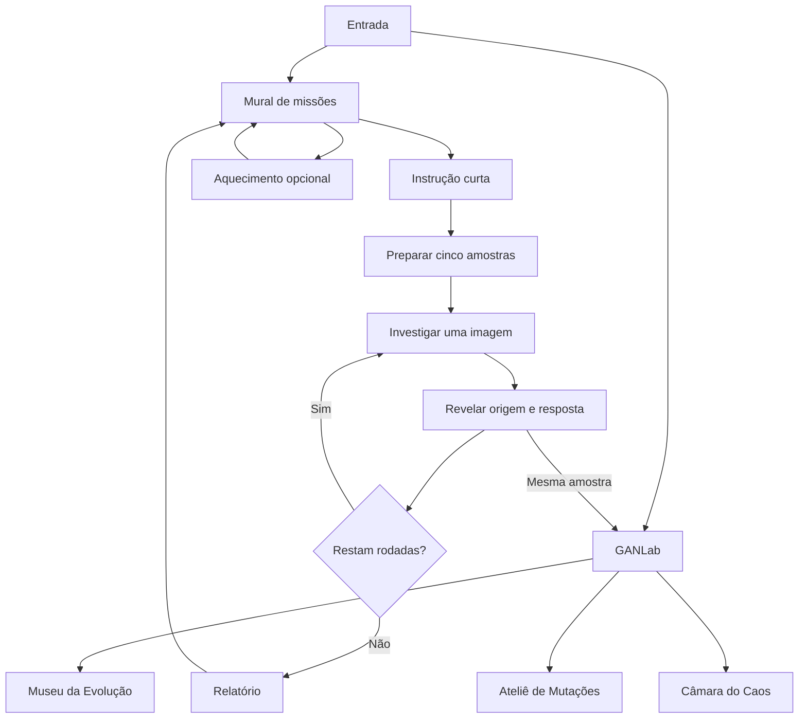
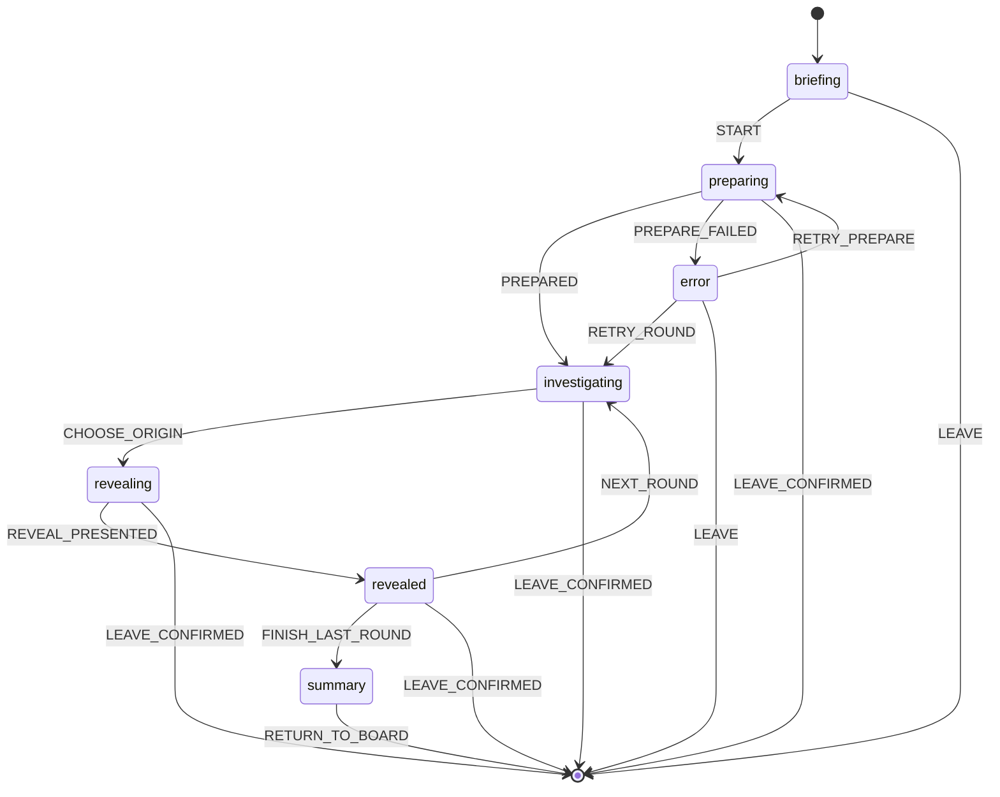

# Etapa 01 — navegação e estados

Fonte de decisão: [experience.v1.json](experience.v1.json). Estes fluxos são especificações da próxima implementação, não alterações já aplicadas às rotas.

## Navegação

| Endereço planejado | Papel |
| --- | --- |
| `/enganai` | Entrada |
| `/enganai/missoes` | Mural novo |
| `/enganai/aquecimento` | Quiz conceitual atual, separado da missão de imagens |
| `/enganai/arena` | Investigação, revelação e relatório como estados da mesma sessão |
| `/enganai/lab` | Explicações e inspeção de uma amostra |
| `/enganai/museu` | Comparação de checkpoints |
| `/enganai/mutacoes` | Geração por semente e interpolação |
| `/enganai/caos` | Comparação de experimentos |

Entrar diretamente na arena sem sessão encaminha ao mural com uma mensagem curta. Abrir o laboratório por uma rodada preserva a sessão na memória enquanto o módulo permanecer montado. O botão de retorno leva à mesma revelação. Navegar para outro caso ou reiniciar exige encerrar a sessão atual.

O laboratório é acessível a qualquer momento. Antes de existir um experimento válido, as áreas de explicação continuam disponíveis; geração e resultados científicos exibem indisponibilidade. O aquecimento não necessita de pesos e mantém seu placar conceitual separado.

## Estados da missão

| Estado | Dados e controles disponíveis | Saída |
| --- | --- | --- |
| briefing | Missão selecionada; nenhuma rodada/nenhuma resposta | Iniciar ou voltar |
| preparing | Semente de seleção fixada, carregamento cancelável; rodada ainda não exposta | Lote completo ou erro |
| investigating | Cinco IDs preparados, imagem atual sem gabarito visível; duas respostas ativas | Registrar uma escolha |
| revealing | Escolha e procedência registradas, pontos calculados uma vez; reação breve | Exibir revelação |
| revealed | Origem e escolha visíveis; palpite de D pronto, pendente ou indisponível | Próxima rodada, relatório ou GANLab |
| summary | Cinco respostas, resultado calculado e revisão | Salvar progresso uma vez e retornar |
| error | Mensagem, contexto e destino de recuperação preservados | Tentar novamente ou voltar |

O estado `revealing` existe para apresentação. A saída não espera indefinidamente por D: depois de apresentar a origem, o jogador pode continuar. Movimento reduzido elimina a espera visual. `D_READY` ou `D_FAILED` atualiza somente o palpite da rodada correspondente, sem recalcular os pontos humanos.

Toda tarefa assíncrona precisa identificar sessão, rodada e versão do pedido. Resultado de pedido cancelado, de sessão encerrada ou de outra rodada é ignorado. Nova tentativa usa o mesmo contexto e não acrescenta uma segunda resposta.

## Regras do jogo

1. Cada missão usa cinco IDs distintos, com duas imagens de uma origem e três da outra. Sortear qual origem terá três; embaralhar a ordem.
2. As amostras reais pertencem à partição `arena`, separada de treino, desenvolvimento e teste final. Sintéticas identificam Gerador, checkpoint e vetor z.
3. Antes da resposta, a interface recebe o contrato `question`. Origem, nome do arquivo revelador, semente e checkpoint não aparecem na interface de escolha.
4. A primeira escolha válida fica registrada. Um segundo clique/Enter/toque não cria outra resposta ou outra pontuação.
5. A correção compara a escolha com a procedência. Acerto vale 100; erro vale zero. Sem vidas, cronômetro ou bônus de sequência.
6. O palpite de D é mostrado depois. Pontuação de D igual ou maior que 0,5 resulta em “real”; a pontuação é uma sigmoid do logit, sem alegação de confiança calibrada.
7. O relatório usa as cinco respostas, inclusive erros humanos e erros da Lupa. O jogador pode revisitar cada rodada no laboratório.

Um jogo estático no navegador não oferece sigilo contra quem inspeciona os próprios arquivos. O requisito desta experiência é impedir pistas e gabaritos na interface antes da resposta; não se promete um sistema competitivo com proteção contra inspeção técnica.

## Progressão e persistência

| Caso | Disponibilidade de progressão | Artefato exigido |
| --- | --- | --- |
| Primeiros rastros | Desde o início | Checkpoint inicial registrado |
| Novos padrões | Após concluir Primeiros rastros, com qualquer resultado | Checkpoint intermediário registrado |
| O grande duelo | Após concluir Novos padrões, com qualquer resultado | Checkpoint avançado registrado |

Disponibilidade de progressão e disponibilidade do modelo são verificações diferentes. Um caso liberado pode informar “experimento em preparação” se faltar seu artefato. Não esconder essa situação atrás de um cadeado de progressão. Os papéis inicial/intermediário/avançado não fixam épocas nem garantem melhora monotônica.

Ao entrar em `summary`, salvar a conclusão pelo ID da sessão. Se esse ID já estiver em `completedSessionIds`, não contabilizar novamente. Registrar melhor resultado por missão e quantidade de conclusões. As conquistas iniciais derivam de fatos: primeira missão concluída e todas as três concluídas.

| Informação | Armazenamento e duração |
| --- | --- |
| Sessão em andamento | Memória do módulo; recarregar encerra a sessão |
| Preferências | `enganai.preferences.v1`; padrão com som desligado |
| Progresso | `enganai.progress.v1`; versão, conclusões e melhores resultados |
| Criações | `enganai.creations.v1`; vetor e identidade do modelo, não apenas seed |
| Seeds ilustrativas antigas | `enganai-seeds`; importação opcional somente dos números |

Se o navegador bloquear o armazenamento, a missão continua e informa que os dados serão mantidos apenas na visita. Dados inválidos ou de versão desconhecida não são aplicados silenciosamente nem apagados sem uma ação explícita. Reiniciar uma missão não apaga o progresso global. Limpar progresso exige uma ação própria com confirmação local.

## Falhas e retorno

| Evento | Resposta da interface |
| --- | --- |
| Sem manifesto/pesos | Explicar indisponibilidade; oferecer aquecimento e GANLab |
| Falha ao preparar imagens | Preservar missão e seed; oferecer nova tentativa |
| Amostra não carrega | Não substituir silenciosamente; tentar carregar a mesma amostra ou voltar |
| D falha após a escolha | Mostrar origem e pontos; indicar que o palpite da Lupa está indisponível |
| Usuário sai durante carregamento | Cancelar tarefas; ignorar respostas tardias |
| Usuário sai durante missão | Confirmar encerramento da sessão; preservar progresso já concluído |
| Checkpoint não existe no Museu | Informar a ausência e permitir selecionar outro registro |
| Interpolação responde fora de ordem | Mostrar apenas o pedido mais recente com o mesmo modelo e contexto |

## Foco e teclado

Na troca de rota, posicionar o foco no título. Após escolher a origem, anunciar o resultado e levar o foco ao controle de continuação quando a revelação estiver disponível. Ao avançar, focar o enunciado da próxima rodada. No relatório, focar o título do resultado.

Escape fecha diálogos e devolve foco ao acionador. As duas respostas são botões nativos, acionáveis por Tab, Enter e Espaço. Cada evidência possui descrição neutra antes da resposta; a descrição de procedência só é acrescentada na revelação. Sons e reações das personagens nunca são a única forma de comunicar o resultado.
