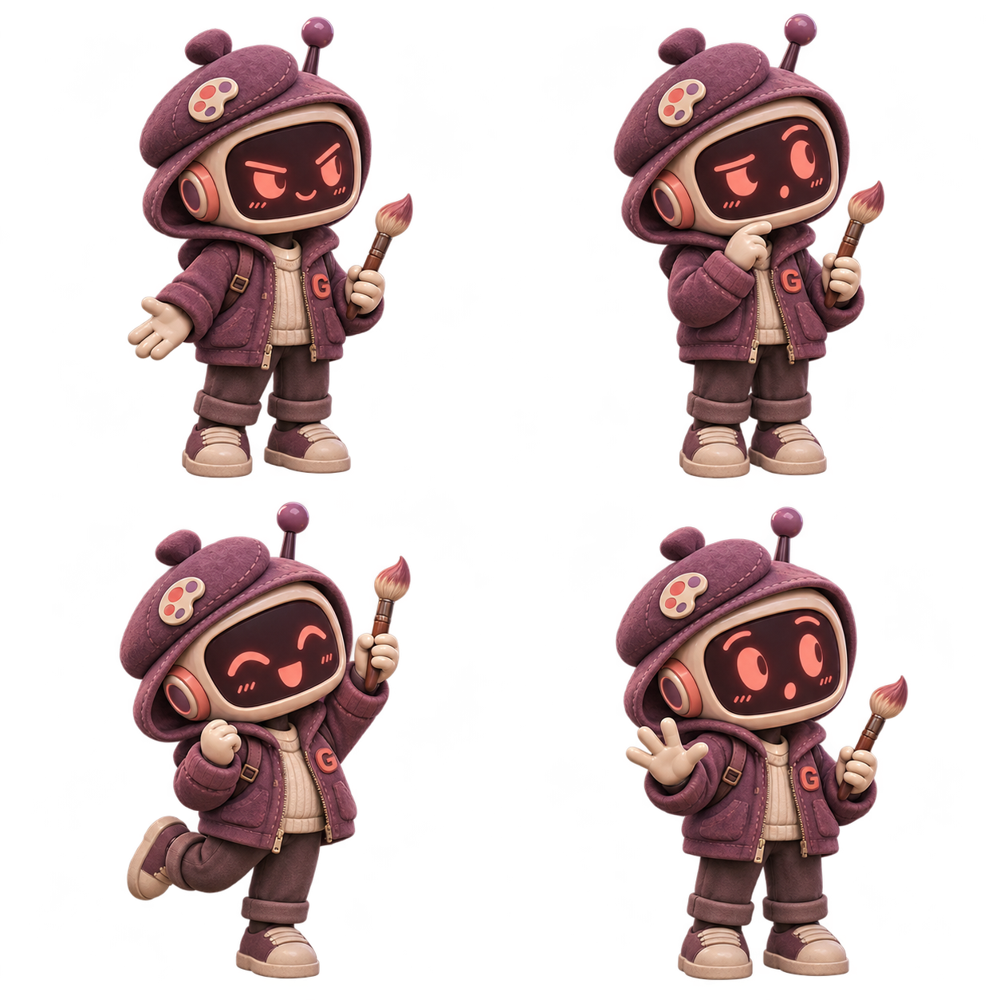
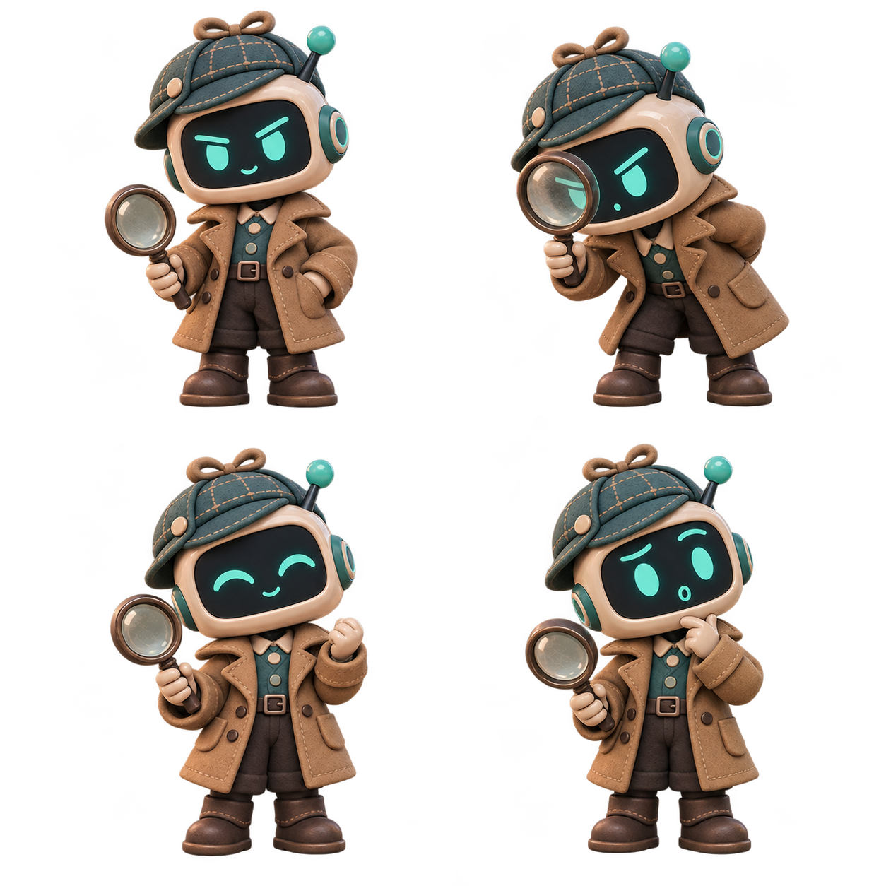

# enGAN.AI — Etapa 01 concluída

Direção de arte: **Ateliê de Investigação dos Pixels**. Esta etapa consolida as referências aprovadas em decisões de produto, especificação visual, fluxos e contratos verificáveis para a implementação.

## Entregas

| Documento | Uso |
| --- | --- |
| [Design e conteúdo](DESIGN.md) | Marca, tipografia, cores, componentes, personagens e comportamento móvel |
| [Fluxos e regras](FLUXOS.md) | Navegação, estados da missão, pontuação, falhas e progresso |
| [Contratos](CONTRATOS.md) | Estruturas de dados e invariantes entre os registros |
| [Critérios de aceite](ACEITE.md) | Evidências de fechamento desta etapa e limites da entrega |
| [Tokens](tokens.v1.json) | Valores de referência para o CSS da etapa 02 |
| [Experiência](experience.v1.json) | Regras e catálogo de telas/missões em formato legível por ferramentas |
| [Inventário de arte](assets.v1.json) | Referências e lista de assets de produção da próxima etapa |
| [JSON Schema](contracts/schema.v1.json) | Doze contratos v1 em JSON Schema 2020-12 |
| [Exemplos](contracts/examples.v1.json) | Dezesseis registros fictícios coerentes para validar a integração futura |
| [Validação](VALIDACAO.json) | Resultado reproduzível da checagem dos contratos e cores |

As telas aprovadas continuam em [proposta-v2](../proposta-v2/README.md). A entrega visual adicional são duas folhas de quatro expressões, geradas com a ferramenta integrada ChatGPT Imagem. Figurinos, formas e materiais dessas folhas passam a orientar a produção dos assets de cena.

## Personagens consolidadas

Ordem em ambas as folhas: repouso no alto à esquerda; pensamento no alto à direita; comemoração embaixo à esquerda; surpresa/erro embaixo à direita. São referências de identidade e pose. O alinhamento final dos recortes será preparado na etapa 02.





[Prompts completos e referência usada](referencias/prompts.json).

## Decisões fechadas

- Marca **enGAN.AI**, leitura “engana aí”; assinatura “Engana aí. Aprende aqui.”.
- Cinco rodadas sem cronômetro; 100 pontos por acerto; máximo de 500.
- Três casos em sequência; completar uma missão libera a próxima, independentemente da pontuação.
- Tutorial conceitual opcional e acesso livre aos ambientes científicos.
- Origem registrada define o gabarito; a saída da Lupa aparece depois da resposta e pode estar errada.
- Progresso e preferências locais. Uma recarga encerra a missão ainda não concluída.
- Som inicialmente desligado; movimento reduzido respeitado.
- Pesos, épocas, dimensões latentes e configurações de treinamento serão definidos e registrados nas etapas científicas, sem copiar números dos mockups.

## Reproduzir a validação

```bash
python3 docs/enganai/etapa-01/validate.py
```

O script usa `jsonschema`. Para um ambiente sem essa dependência:

```bash
python3 -m venv /tmp/enganai-contracts-venv
/tmp/enganai-contracts-venv/bin/pip install -r docs/enganai/etapa-01/requirements-validation.txt
/tmp/enganai-contracts-venv/bin/python docs/enganai/etapa-01/validate.py
```

Resultado desta entrega: **12 contratos, 16 exemplos válidos, 16 casos inválidos rejeitados e 7 pares de contraste aprovados**. Os exemplos usam `dataMode: fixture`, caminhos sem arquivos e hashes nulos; não são resultados de um modelo. O validador também verifica as fontes e referências visuais locais.

## Continuidade

A etapa 02 implementará o novo enquadramento, cenários, mural e controles com base nesta especificação. Nesta etapa 01, a aplicação navegável continua com a base anterior; os contratos e referências ficam separados do runtime. Treinamento, inferência e missão com imagens reais pertencem às etapas 03–05.
