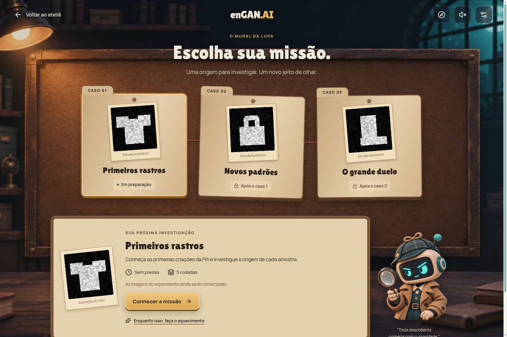
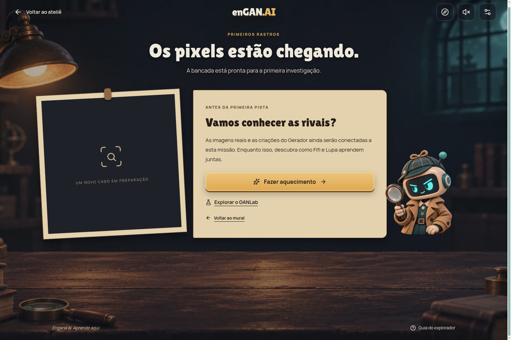
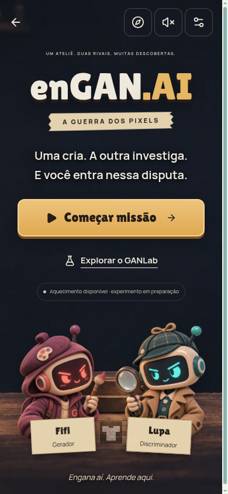

# enGAN.AI — Etapa 02: cena e navegação

O Ateliê de Investigação dos Pixels passa a ser a interface navegável do módulo. A entrada prioriza as duas rivais e o convite para começar; o mural organiza os casos em pastas; a bancada apresenta o estado de preparação do experimento. O menu lateral foi substituído por controles compactos de ambientes, som e preferências.

## O que está implementado

| Experiência | Comportamento |
| --- | --- |
| Entrada | Cenário amplo, marca em HTML, Fifi/Lupa em camadas independentes, chamada para o mural e acesso ao GANLab |
| Mural | Três casos selecionáveis, descrição, pré-requisitos e leitura validada de conclusões locais; a seleção leva foco e rolagem até os detalhes |
| Bancada | Estado explícito de experimento em preparação, retorno ao mural e convite ao aquecimento |
| Aquecimento | Quiz opcional com três perguntas, feedback, poses de comemoração/surpresa, reinício e resultado independente |
| Ambientes científicos | GANLab, Museu, Mutações e Caos com materiais, tipografia e controles coerentes com o ateliê; conteúdo conceitual preservado |
| Preferências | Explicações intuitivas/técnicas, movimento reduzido, som opcional e redefinição; estado local versionado |
| Ajuda e navegação | Janelas nativas com foco contido, Escape, retorno ao acionador, guia e glossário |

Nenhuma missão com imagens reais é simulada nesta entrega. O aquecimento não grava `enganai.progress.v1`, não pontua uma GAN e não desbloqueia casos. O mural rejeita fixtures ou registros inconsistentes sem apagá-los. A arena sem caso válido encaminha ao mural.

## Arte de produção

Os cenários e bustos foram criados com **ChatGPT Imagem integrado**, usando a direção aprovada e as identidades da etapa 01 como referências. Textos, botões, painéis e desenhos didáticos são HTML/SVG/CSS. Os cenários não contêm controles pintados.

| Arquivo em `public/images/enganai/atelier/` | Função | Tamanho aproximado |
| --- | --- | --- |
| `atelier.webp` | Cenário da entrada | 64 KiB |
| `mural.webp` | Cenário de cortiça e madeira | 172 KiB |
| `bancada.webp` | Cenário dos instrumentos e arena | 79 KiB |
| `fifi.webp` | Busto transparente, figurino ameixa | 211 KiB |
| `lupa.webp` | Busto transparente, figurino petróleo/castanho | 232 KiB |
| `fifi-expressions.webp`, `lupa-expressions.webp` | Folhas 2 × 2 para as reações | 247 KiB cada |

O cenário inicial e os dois bustos somam aproximadamente **508 KiB**, abaixo da meta de 1500 KiB da etapa 01. As fontes locais somam cerca de 188 KiB. As expressões são carregadas quando utilizadas. As conversões WebP preservam o alpha; os PNGs originais permanecem no diretório de imagens geradas do Codex.

[Prompts completos dos cenários e bustos](../../../public/images/enganai/atelier/prompts.json). [Prompts das folhas de expressões](../etapa-01/referencias/prompts.json). A capa anterior permanece apenas no catálogo geral do ChAprendizagem.

## Preferências e recursos

`enganai.preferences.v1` segue o contrato v1 com `dataMode: recorded`. Formato futuro, fixture e JSON danificado são preservados; novos ajustes valem em memória até a redefinição explícita. Falha de armazenamento mantém os controles utilizáveis nesta visita.

O som começa desligado. Ao ativá-lo, o navegador cria uma ambiência sintetizada suave com Web Audio; nenhum arquivo musical é baixado. Após recarregar, uma preferência de som salvo oferece “Retomar som ambiente”, sem autoplay. Ao desligar ou sair do módulo, os recursos são suspensos/liberados. Retornos tardios de inicialização não ativam som cancelado.

Movimento reduzido combina a preferência do sistema com a opção manual. As flutuações, transições e a reprodução automática do Museu são desativadas; seleção manual continua disponível. Os controles têm foco visível, e o feedback do quiz conduz o foco ao próximo passo.

## Verificação

- `npm run lint`: sem erros ou avisos.
- `npm test`: 154 testes aprovados, incluindo cinco testes novos de persistência, progresso e áudio.
- `npm run build`: produção compilada.
- `python3 docs/enganai/etapa-01/validate.py`: 12 contratos, 16 exemplos, 16 rejeições e 7 pares de contraste aprovados.
- `npm run test:enganai:browser`: oito rotas em 320, 390, 768 e 1440 px; fluxo mural/bancada/aquecimento, bloqueios, isolamento do placar, preferências após recarga, dados futuros preservados, armazenamento bloqueado, som, Tab/Escape, glossário e movimento reduzido.
- Viewport lógico de 720 × 480 com escala 2 para inspecionar a composição equivalente a uma janela desktop ampliada; sem transbordamento horizontal nos controles verificados.

A prévia integrada do chat estava indisponível. A revisão usou Chromium local em modo headless e capturas da própria aplicação. O relatório reproduzível está em [browser-report.json](browser-report.json). Isso não equivale a uma auditoria completa com leitores de tela ou testes em todos os dispositivos físicos.

Para reproduzir no servidor de produção:

```bash
npm run build
npm run preview -- --port 4173
# Em outro terminal:
ENGANAI_URL=http://127.0.0.1:4173 npm run test:enganai:browser
```

`CHROME_BIN` permite indicar o executável do Chromium. As capturas são atualizadas em `previews/`.

## Capturas implementadas








## Próxima etapa

Etapa 03: preparar Fashion-MNIST, implementar e treinar a DCGAN, registrar configurações, checkpoints e histórico. Inferência no navegador e a missão real continuam nas etapas 04–05. Nenhum peso, época, perda ou previsão foi inventado para preencher esta interface.
