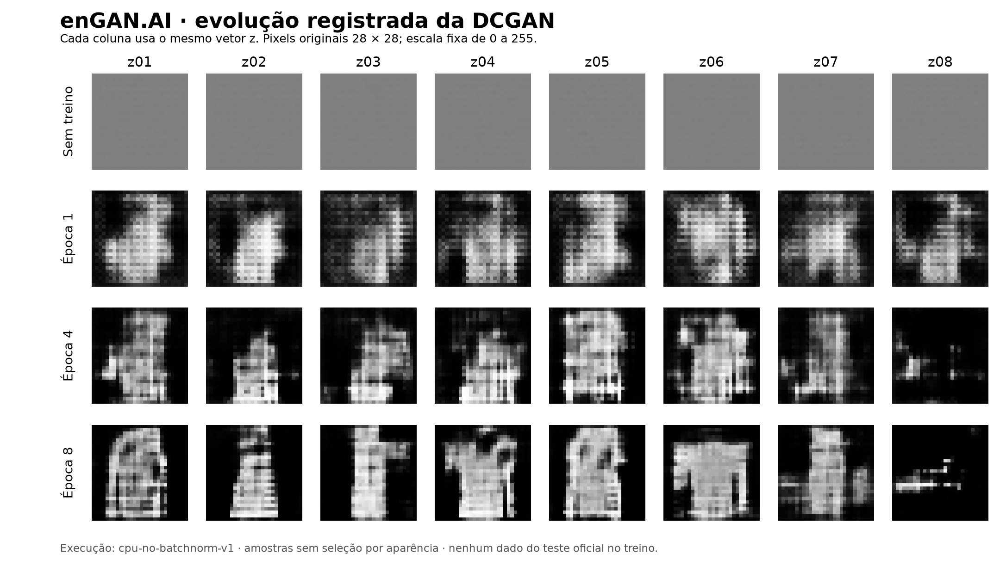
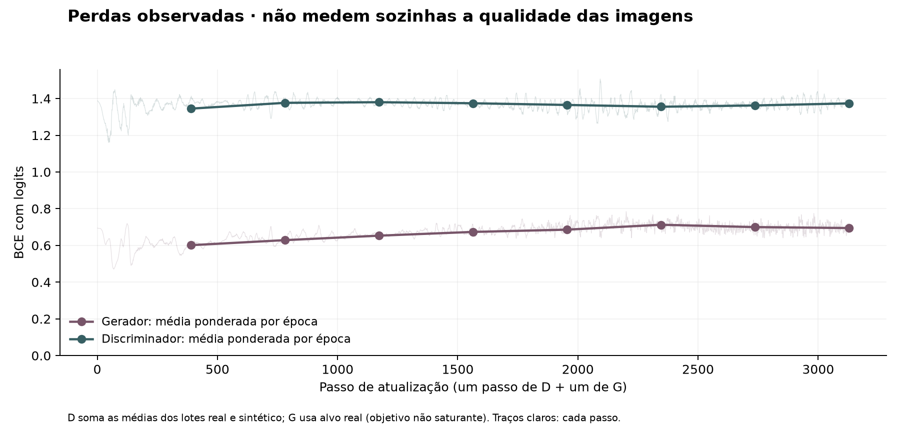

# enGAN.AI — Etapa 03: DCGAN real

Esta etapa implementa o pipeline científico: Fashion-MNIST verificado, partições registradas, Gerador e Discriminador treinados em PyTorch, checkpoints, perdas, amostras e reprodução dos pixels a partir dos pesos. As imagens abaixo são saídas reais de G, sem retoque ou seleção das melhores amostras.

O frontend permanece na etapa 02. Os arquivos publicados são de pesquisa, com `runtime: pytorch` e `browserReady: false`. A próxima etapa exportará e validará a inferência no navegador; a missão de cinco imagens depende também da etapa 05.

## Dados e configuração

| Item | Registro |
| --- | --- |
| Dataset | Fashion-MNIST oficial, commit de origem fixado e licença incluída |
| Treino | 50.000 imagens, 5.000 de cada classe |
| Desenvolvimento | 5.000 imagens; 512 entradas fixas usadas nos diagnósticos |
| Arena | 5.000 imagens reservadas, sem uso no treinamento |
| Teste oficial | 10.000 imagens preservadas, sem avaliação nesta etapa |
| Entrada de G | Normal padrão, z com 64 dimensões, formato NCHW |
| Saída de G | 1 × 28 × 28, float32 em [-1, 1] |
| Saída de D | Um logit por imagem; Sigmoid não faz parte da rede |
| Otimizadores | Adam, taxa 0,0002 para G/D, betas 0,5/0,999 |
| Treino por execução | Oito épocas completas, lotes de 128, 3.128 pares de atualizações |
| Checkpoints | Inicialização (0), épocas 1, 4 e 8 |
| Comparação visual | Dezesseis vetores z salvos; a figura mostra os primeiros oito, na mesma ordem |
| Execução | CPU, duas threads por processo; Python 3.12.14 e PyTorch 2.15.0+cpu |

Arquivos de dados são conferidos com os MD5 publicados pelos autores e SHA-256 registrados localmente. Partições são estratificadas e disjuntas por ID, com cobertura integral dos dois conjuntos oficiais. O preparo decodifica o teste para conferir o formato; treino e diagnóstico não o usam como avaliação. [Fonte do dataset](https://github.com/zalandoresearch/fashion-mnist).

## Duas execuções registradas

`cpu-baseline-v1` usa BatchNorm no Discriminador. Suas perdas de treino caíram, mas o diagnóstico em modo de avaliação divergiu: na última época D acertou 248/512 imagens reais e 0/512 sintéticas, totalizando 24,22% nesse conjunto balanceado. Isso impediu tratá-lo como uma configuração satisfatória só porque as perdas ficaram pequenas.

`cpu-no-batchnorm-v1` remove BatchNorm de D, mantendo-a em G. Dados, seeds, lotes, taxas e cronograma permanecem iguais. Sem normalização por lote ou estatísticas móveis em D, os logits de uma imagem são consistentes entre treino e inferência; um teste verifica essa propriedade. No diagnóstico final, D acertou 247/512 imagens reais e 370/512 sintéticas, totalizando 60,25%. Esta variante é a referência para a etapa de exportação. A comparação é exploratória, sem uma busca extensa de hiperparâmetros.

G tem **234.176 parâmetros**. D tem **10.080** na primeira configuração e **10.016** na variante sem BatchNorm. A arquitetura, os pesos efetivos e as versões do código estão nos registros de cada execução.

O checkpoint ativo é sempre a última época declarada antes de cada execução. Os resultados finais e a comparação numérica estão em [resultado.json](resultado.json) e [comparacao.json](comparacao.json). Os diagnósticos de D usam 512 imagens reais do desenvolvimento e 512 saídas float32 atuais de G, com entradas fixas. São diagnósticos desse par G/D; não são qualidade perceptual, acurácia no teste ou detecção geral de IA.

Na segunda execução houve um encerramento do processo após o checkpoint 4. A retomada restaurou pesos, Adam, estado do ruído Torch e permutações NumPy. O registro guarda o ponto de retomada e novos snapshots do código; o histórico final contém cada passo apenas uma vez. Um teste exige igualdade das perdas, pesos e buffers entre uma atualização contínua e a atualização retomada. O tempo de execução registrado exclui o período offline e trabalho parcial descartado.

## Evolução e perdas observadas

Os pixels originais têm 28 × 28 e são ampliados por vizinho mais próximo. A escala é fixa entre todas as imagens. As amostras ainda apresentam ruído, padrões de grade e formas incompletas: esta é uma configuração inicial de estudo. A figura também permite observar mudanças que não representam melhora contínua.

As curvas usam valores efetivamente registrados. D soma as médias das perdas dos lotes real e sintético; G usa o objetivo não saturante com alvo real. Pontos destacados são médias ponderadas pelo tamanho dos lotes. Perdas menores, imagens quantizadas diferentes e maior dispersão de pixels não demonstram, isoladamente, qualidade ou ausência de colapso de modos.

[Evolução da primeira configuração](comparacao/baseline/evolucao.png) e [perdas da primeira configuração](comparacao/baseline/perdas.png) permanecem disponíveis para comparação.

## Artefatos para a próxima etapa

- [Execução de referência](../../../public/models/enganai/research/cpu-no-batchnorm-v1/run.json): ambiente, arquitetura, configuração, fonte e cobertura do treino.
- [Checkpoints](../../../public/models/enganai/research/cpu-no-batchnorm-v1/checkpoints.json): épocas, passos, pesos identificados e prévias.
- [Vetores fixos](../../../public/models/enganai/research/cpu-no-batchnorm-v1/fixed-latents.json): valores completos, distribuição e RNG.
- [Histórico](../../../public/models/enganai/research/cpu-no-batchnorm-v1/history.json): uma entrada por atualização.
- [Verificação da execução](../../../public/models/enganai/research/cpu-no-batchnorm-v1/verification.json): hashes, schemas e reprodução das prévias.
- [Pipeline e reprodução](../../../training/enganai/README.md): ambiente, comandos, preparação, treino e retomada.

Os registros `dataset-split`, `latent-set`, `checkpoint`, `history` e `sample` passam pelos schemas aprovados na etapa 01. Cada amostra sintética aponta para sua execução, checkpoint, hash de G e vetor z. Não foi criado um manifesto ONNX antes de haver exportação e paridade verificadas.

Para preparar o Museu, a inicialização e as épocas 1/4/8 fornecem uma sequência com o mesmo z. As épocas 1, 4 e 8 são candidatas cronológicas para os três casos; dificuldade e disponibilidade serão definidas na integração com base nas evidências, sem supor que a última época sempre é melhor.

## Verificação da entrega

- Oito testes Python: IDX, partições, formatos, normalização, perdas extremas, isolamento de gradientes, repetibilidade, pesos recarregados, consistência de D e retomada.
- Smoke real com 1024 imagens, 16 passos e 32 prévias reproduzidas, sem publicação como modelo completo.
- Duas execuções completas; cada uma com 71 registros científicos validados, quatro checkpoints e 64 prévias regeneradas sem diferença nos pixels.
- Diagnósticos finais recalculados a partir dos pesos e entradas de desenvolvimento.
- Alteração dos bytes dos pesos, mudança do z na procedência e publicação de fixture rejeitadas na verificação de integração.
- 154 testes JavaScript, lint, build e validação dos contratos da etapa 01.

Comandos principais: `npm run check:enganai`, `npm run test:enganai:training`, `npm run verify:enganai` e `npm run report:enganai`. O conjunto de evidências está em [VALIDACAO.json](VALIDACAO.json).

## Próxima etapa

Etapa 04: exportar G/D para ONNX, estabelecer tolerâncias com comparação numérica, validar operações e desempenho no navegador e implementar o carregador/worker. Os estados de carregamento e erro deverão preservar o contexto e nunca substituir uma falha por imagem ou previsão fictícia.
