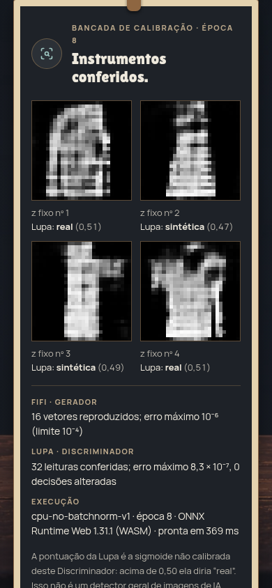

# enGAN.AI — Etapa 04: inferência na aplicação

O Gerador e o Discriminador treinados na [etapa 03](../etapa-03/README.md) agora rodam no navegador. Os quatro checkpoints de `cpu-no-batchnorm-v1` foram exportados para ONNX. A paridade com PyTorch foi medida, e o manifesto `model-manifest` da etapa 01 foi publicado. Um worker executa G e D com ONNX Runtime Web. A bancada da arena carrega, confere e mostra as redes, com estados de carregamento, indisponibilidade e nova tentativa.

A missão jogável de cinco rodadas continua na etapa 05. A bancada não sorteia amostras da partição `arena`, não pontua e não grava progresso.

## Decisão: PyTorch → ONNX → ONNX Runtime Web

O plano pedia para validar a ponte antes de escolher a integração definitiva. O teste atendeu ao contrato, então **não é necessário um serviço de inferência**: a entrega continua estática.

| Critério | Evidência |
| --- | --- |
| Operações | G: `ConvTranspose`, `Relu`, `Tanh`. D: `Conv`, `LeakyRelu`, `Reshape`. A BatchNorm de G (modo avaliação) foi incorporada às convoluções pelo otimizador do exportador. Uma lista de operações permitidas rejeita qualquer outra |
| Interface | `latent` float32 `N × 64 × 1 × 1` → `image` `N × 1 × 28 × 28`; `image` → `logit` `N × 1`. Lote dinâmico de 1 a 1024, opset 18 e pesos embutidos no arquivo |
| Reprodutibilidade | Duas exportações produzem bytes idênticos; `npm run verify:enganai:onnx` reexporta e compara os hashes |
| Tamanho | G ≈ 925 KiB e D ≈ 49 KiB por checkpoint. O runtime WASM tem 14,8 MB (3,8 MB com gzip) e só é baixado na bancada |
| Desempenho | No Chromium headless (CPU, WASM, uma thread), a bancada ficou pronta entre 564 ms e 913 ms em carga fria: runtime, pesos, verificação e amostras. Voltar ao mesmo checkpoint no mesmo documento levou 76 ms |

As medidas de tempo vêm de uma execução local em uma única máquina. Elas mostram a ordem de grandeza e não constituem uma garantia para outros dispositivos. A execução por GPU (WebGPU) fica como otimização posterior, conforme o plano.

## Tolerâncias de paridade

As tolerâncias foram declaradas no exportador e são usadas pelo Python, pelo teste Node e pelo navegador. Um runtime diferente pode reordenar somas em float32, então a comparação usa margens, não igualdade de bits.

| Grandeza | Limite | Maior erro medido (4 checkpoints) |
| --- | --- | --- |
| Saída de G, valor float em [−1, 1] | 1 × 10⁻⁴ | 1,1 × 10⁻⁶ (ORT Python); 1,0 × 10⁻⁶ (ORT Web) |
| Pixel quantizado 0–255 | diferença ≤ 1 em até 0,2% dos pixels | ≤ 2 de 401.408 pixels em 1 nível; 0 nas 64 prévias registradas e nas telas da bancada |
| Logit de D | 1 × 10⁻⁴ + 1 × 10⁻⁴·\|logit\| | 1,0 × 10⁻⁶ (ORT Python); 8,3 × 10⁻⁷ (ORT Web) |
| Decisão de D (`score ≥ 0,5`) | só pode mudar se o logit de referência estiver dentro da faixa de tolerância | nenhuma mudança |

A margem entre o erro medido e o limite é de cerca de 100 vezes. As poucas diferenças de 1 nível nos pixels são arredondamentos na fronteira entre dois valores inteiros. A quantização em JavaScript replica `torch.round`, que arredonda o meio para o par, e usa aritmética float32.

O que foi comparado, para cada checkpoint (épocas 0, 1, 4 e 8):

- G com os 16 vetores fixos, em lote e um a um, e com os 512 vetores dos diagnósticos.
- D com as saídas de G desses vetores e com as 512 imagens reais de desenvolvimento.
- Os pixels das 64 prévias PNG registradas na etapa 03, regenerados pelo ONNX.

O teste oficial e a partição `arena` não foram usados.

## Artefatos publicados

Os arquivos ficam ao lado da execução de pesquisa, em `public/models/enganai/research/cpu-no-batchnorm-v1/`, para preservar o vínculo por hash com os pesos `.pt` de origem.

| Arquivo | Conteúdo |
| --- | --- |
| [`model-manifest.json`](../../../public/models/enganai/research/cpu-no-batchnorm-v1/model-manifest.json) | Contrato `model-manifest` v1: runtime `onnx`, tensores, domínio da imagem, espaço latente, hashes de G/D do checkpoint ativo (época 8), configuração, partições e ambiente |
| [`onnx-export.json`](../../../public/models/enganai/research/cpu-no-batchnorm-v1/onnx-export.json) | Os quatro checkpoints: arquivos ONNX, hash dos pesos `.pt` de origem, operações, referências, paridade Python, tolerâncias, versões e runtime do navegador |
| `onnx/epoch-NNN/{generator,discriminator}.onnx` | Redes exportadas |
| `onnx/epoch-NNN/reference-generator.f32` | Saídas float32 do PyTorch para os 16 vetores fixos |
| `onnx/reference-real.u8` | As 16 primeiras imagens reais de desenvolvimento dos diagnósticos (registros identificados no export) |
| `onnx/source/` | Cópias identificadas por SHA-256 do código e do lock usados na exportação |

`run.json` continua com `runtime: pytorch` e `browserReady: false`, porque descreve a execução de treinamento. A prontidão para o navegador é declarada pelo manifesto ONNX e pelo registro de exportação.

## Carregamento na aplicação

| Peça | Papel |
| --- | --- |
| `lib/inference/contract.js` | Valida manifesto e exportação, rejeita fixtures, confere SHA-256 (com implementação própria quando `crypto.subtle` não existe), quantiza como o PyTorch e produz a leitura `discriminator` do contrato |
| `lib/inference/engine.js` | Motor independente do ambiente: baixa e confere bytes, cria as sessões, confere nomes/formatos e executa `verifyCheckpoint`, `generate`, `discriminate` e `sampleFixed` |
| `lib/inference/inference.worker.js` | Worker ES; importa `onnxruntime-web/wasm` somente quando chamado. Usa uma thread, porque o site não exige isolamento cross-origin |
| `lib/inference/client.js` | Correlaciona pedidos por ID, repassa progresso, aplica tempo-limite e cancelamento e reinicia o worker após falha ou travamento. Respostas tardias nunca chegam a um contexto mais novo |
| `hooks/useBenchInference.js` | Estado da bancada por checkpoint e tentativa; resultados antigos são ignorados |
| `components/InferenceBench.jsx` | Interface da bancada |

Cada vez que a bancada abre um checkpoint, ela repete a verificação de paridade antes de mostrar qualquer imagem. Se as saídas não reproduzirem a referência, a bancada entra em erro. Leituras de D seguem o contrato: `score = sigmoid(logit)`, “real” quando `score ≥ 0,5`, `meaning: uncalibrated-sigmoid`.

## Bancada

Cada caso do mural aponta, por enquanto, para um checkpoint em ordem cronológica: **Primeiros rastros** → época 1, **Novos padrões** → época 4, **O grande duelo** → época 8. Esse vínculo é provisório. A etapa 05 ajusta a dificuldade com base nos resultados observados, sem supor que uma época posterior seja sempre melhor.

| Estado | O que aparece |
| --- | --- |
| Carregando | Quatro passos: motor, manifesto/vetores, assinatura dos pesos e reprodução das referências |
| Pronta | G(z) para os vetores fixos 1–4, gerados no navegador e desenhados pixel a pixel. Inclui a leitura da Lupa com score não calibrado, os erros de paridade com os limites, a execução, a época, a versão do runtime e o tempo |
| Erro | Mensagem do motivo (rede, integridade, contrato ou paridade), foco no título e “Tentar novamente”. A tentativa cria um worker novo e mantém o caso selecionado. Nenhuma imagem ou palpite ocupa o lugar |
| Indisponível | Sem Web Worker ou WebAssembly: explicação, sem imagens; o restante do ateliê continua acessível |

Menu e mural não baixam runtime nem pesos. Movimento reduzido desativa o indicador giratório.




[Bancada indisponível sem WebAssembly](previews/bancada-indisponivel-desktop.png).

Na época 8, as leituras da Lupa ficam perto de 0,5 para as quatro criações. Isso mostra o estado registrado deste par G/D, não um defeito da exportação: os logits coincidem com o PyTorch. A interface lembra que esse score não é um detector geral de imagens de IA.

## Verificação

- `npm run export:enganai:onnx`: verifica a execução de pesquisa e exporta os quatro checkpoints. Mede a paridade e publica somente se tudo passar.
- `npm run verify:enganai:onnx`: valida o pacote publicado, reexporta em diretório temporário e exige bytes idênticos.
- `npm run test:enganai:training`: 12 testes Python, incluindo quatro novos para regras de tolerância, NaN, decisões perto de zero e rejeição de pacotes adulterados.
- `npm test`: 165 testes. Onze são novos em `tests/enganai-inference.test.js`. Eles rodam a paridade dos quatro checkpoints no próprio `onnxruntime-web` (build Node) e testam quantização, SHA-256, leitura de D e contratos. Também rejeitam fixtures, pesos trocados, operações desconhecidas e bytes alterados, e cobrem tempo-limite, cancelamento e reinício do worker.
- `npm run test:enganai:inference-browser`: Chromium com o build de produção. O [relatório](browser-report.json) cobre:
  - nenhum download de modelo na entrada e no mural;
  - paridade e pixels exibidos idênticos à referência PyTorch nas épocas 1, 4 e 8;
  - reaproveitamento das sessões;
  - falha de rede no worker, com erro, foco e nova tentativa;
  - pesos adulterados rejeitados por SHA-256;
  - 390 px sem rolagem horizontal;
  - movimento reduzido;
  - indisponibilidade sem WebAssembly.
- Regressão da etapa 02 (`ENGANAI_PREVIEW_DIR` evita sobrescrever as capturas daquela etapa): 32 combinações de rota e largura, sem erros.
- `npm run lint`, `npm run build`, `npm run verify:enganai` e `python3 docs/enganai/etapa-01/validate.py`.

Para reproduzir a verificação no navegador:

```bash
npm run build
npm run preview -- --port 4173
# Em outro terminal:
npm run test:enganai:inference-browser
```

O resumo das evidências está em [VALIDACAO.json](VALIDACAO.json). A verificação usou Chromium headless em uma máquina Linux. Não foram feitos testes em dispositivos físicos variados nem com leitores de tela.

## Próxima etapa

Etapa 05 — missão jogável completa:

- rodadas com amostras da partição `arena` e criações de G com procedência;
- resposta única e pontuação calculada;
- revelação com o palpite da Lupa vindo deste worker;
- relatório e progresso local.

Mutações (etapa 07) poderão usar o mesmo `generate` com vetores interpolados.
