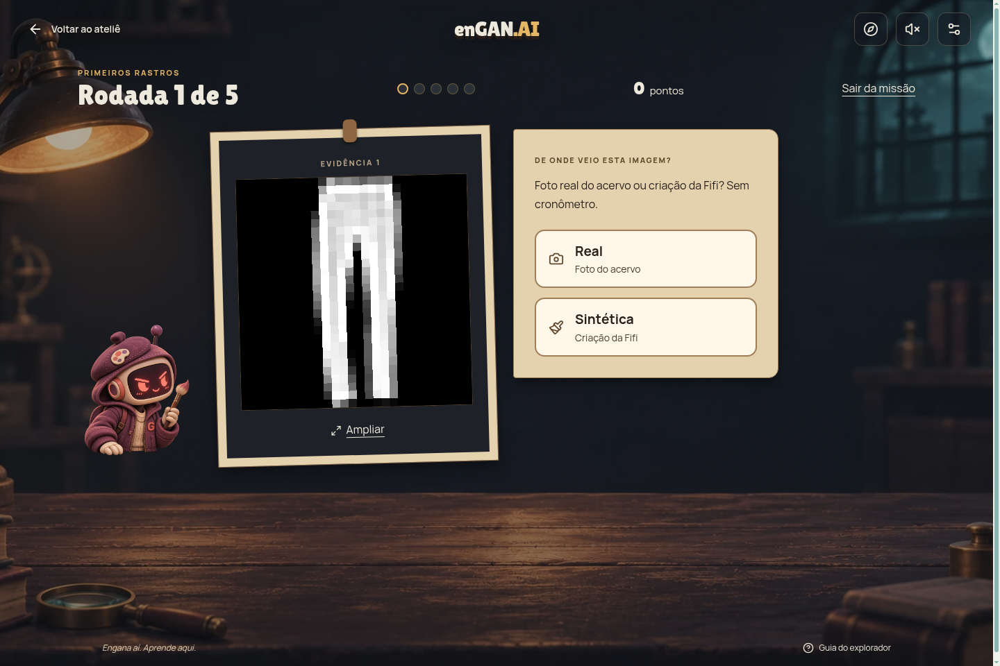
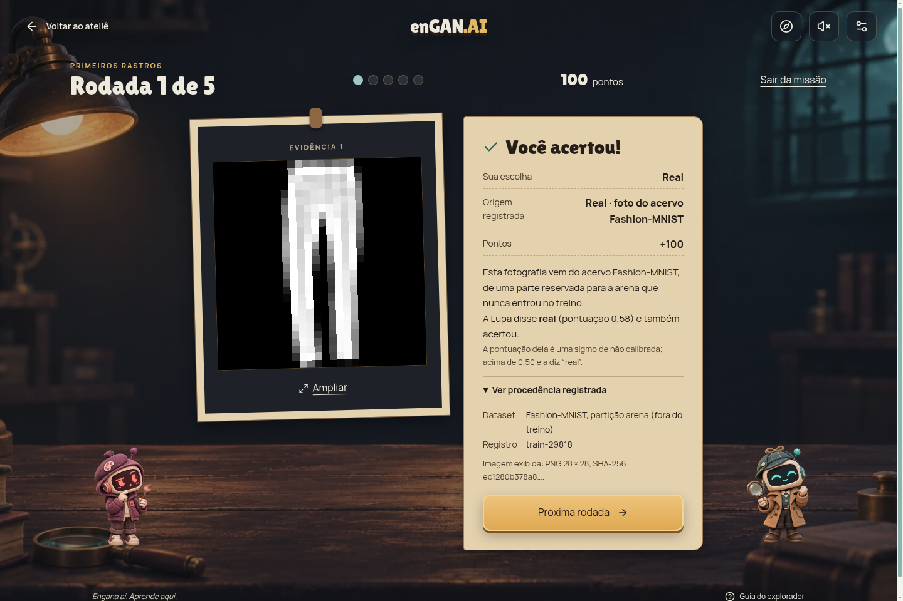
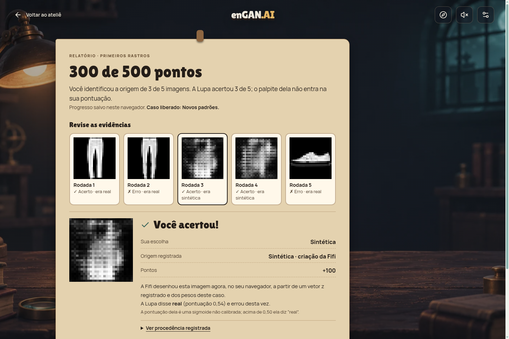
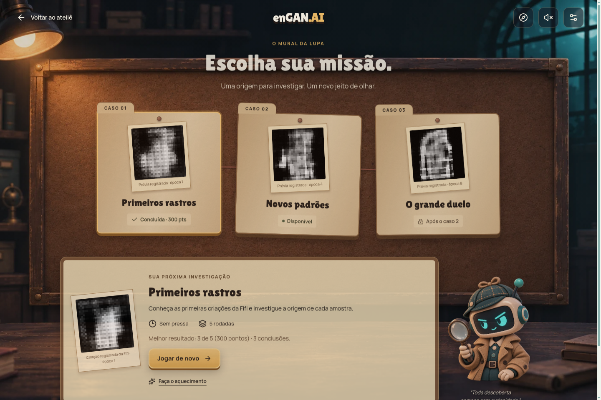
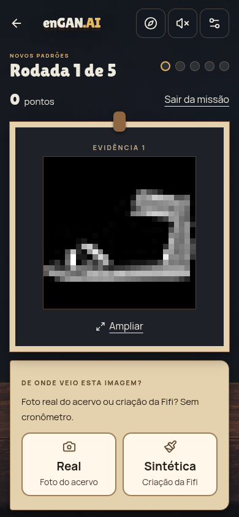

# enGAN.AI — Etapa 05: missão jogável completa

A arena virou jogo. Cada missão tem cinco evidências, misturando fotos reais do acervo Fashion-MNIST e criações da Fifi geradas na hora pelo Gerador treinado. O jogador decide a origem de cada uma, recebe a revelação com o palpite da Lupa e termina com um relatório revisável. O progresso local libera o próximo caso no mural.

Fluxo: `mural → instruções → bancada verificada → preparo → investigação → revelação → … → relatório`.

## Regras implementadas

| Regra | Implementação |
| --- | --- |
| Cinco rodadas, sem cronômetro | `ROUND_COUNT = 5`; nenhum temporizador na rodada |
| Origens variadas | 2 ou 3 reais por missão (as demais sintéticas), em ordem embaralhada. É a regra 2/3 do validador da etapa 01 |
| Sem repetição | Índices distintos dentro de cada origem; os IDs das amostras são opacos (`<sessão>-1` … `-5`) |
| Seleção reproduzível | `planRounds(semente, tamanhos)` com RNG `mulberry32-v1`, usado só para escolher índices. `?semente=N` na URL repete a seleção para depuração |
| Resposta única | O redutor ignora uma segunda resposta, respostas fora da rodada atual e escolhas inválidas. Um clique duplo pontua uma vez |
| Pontuação | 100 por origem correta, de 0 a 500. O score da sessão é sempre a soma das revelações |
| Gabarito | Vem só da procedência registrada da amostra. O palpite da Lupa nunca define acerto nem pontos |
| Antes da resposta | A rodada recebe somente o registro `question`: sessão, missão, amostra, índice e imagem. Não há origem, procedência ou palpite |
| Saída | “Sair da missão” abre uma confirmação nativa: Escape ou “Continuar investigando” mantém a sessão. Fechar a aba durante a missão pede confirmação do navegador |
| Progresso | `enganai.progress.v1`: uma conclusão por ID de sessão, o melhor resultado nunca diminui, os pré-requisitos são respeitados e as conquistas são derivadas. Dados de formato futuro são preservados e não são sobrescritos |
| Reinício | “Jogar de novo” cria uma sessão nova, com outro ID e outra semente. A sessão anterior não é contada outra vez |

A sessão em andamento não é persistida, como previsto no contrato. Sair no meio descarta as respostas.

## De onde vêm as evidências

**Fotos reais.** `npm run prepare:enganai:arena` publica `public/data/enganai/arena/`:

- 500 imagens da partição `arena`, 50 por classe, escolhidas com NumPy PCG64 e semente fixa, nunca pela aparência;
- os rótulos não são publicados;
- treino, desenvolvimento e teste oficial não entram;
- os bytes são conferidos por SHA-256.

**Criações da Fifi.** O conjunto `arena-latents-v1` tem 64 vetores z. Eles foram sorteados com o mesmo RNG declarado no manifesto (`pytorch-cpu-normal-v1`, semente 6011), distinta das sementes de treino, dos vetores fixos e dos diagnósticos. O worker executa G(z) no navegador com o checkpoint do caso. Cada amostra sintética registra execução, checkpoint, hash dos pesos de G e os 64 valores de z. Por isso a imagem pode ser regenerada.

**Imagem exibida.** Os pixels uint8 de cada rodada viram um PNG 28 × 28 determinístico, codificado no navegador. Seu SHA-256 entra no registro `sample` e aparece na procedência. O jogador vê exatamente esses bytes.

**Palpite da Lupa.** D analisa os mesmos pixels uint8 que o jogador vê, para as duas origens, e não a saída float de G. A leitura segue o contrato (`sigmoid(logit)`, “real” se ≥ 0,5, não calibrada). Ela é calculada no preparo, mas só aparece depois da resposta. Se D falhar, a rodada continua; o palpite aparece como indisponível, e os pontos não mudam.

`npm run verify:enganai:arena` reconstrói o conjunto e exige bytes idênticos.

## Casos e checkpoints

O vínculo cronológico da etapa 04 foi mantido: **Primeiros rastros** → época 1, **Novos padrões** → época 4, **O grande duelo** → época 8. Os diagnósticos registrados na etapa 03 (512 reais e 512 sintéticas da partição de desenvolvimento) mostram o que muda entre os casos:

| Época | D acerta reais | D acerta sintéticas | Acurácia balanceada de D |
| --- | --- | --- | --- |
| 1 | 512/512 | 0/512 | 50,0% |
| 4 | 315/512 | 282/512 | 58,3% |
| 8 | 247/512 | 370/512 | 60,3% |

Na época 1, a Lupa chama tudo de “real”. As criações dessa época ainda são ruidosas, e o jogador costuma percebê-las com facilidade. Os registros sustentam diferença entre os casos, então o vínculo permanece. Esses números medem o Discriminador. **Não medem a dificuldade para pessoas**: não houve teste com jogadores. Uma calibração por resultados humanos fica para a etapa 09.

## Telas

| Tela | O que mostra |
| --- | --- |
| Instruções | Bancada da etapa 04 conferindo G/D do caso, três regras curtas e “Começar investigação” habilitado só com a bancada pronta |
| Investigação | Evidência ampliável, a pergunta “De onde veio esta imagem?”, duas escolhas grandes, trilha das cinco rodadas e pontos. Fifi e Lupa nas margens, em pose neutra/pensativa |
| Revelação | Acerto ou erro (ícone e texto), sua escolha, origem registrada, pontos, explicação do registro, palpite da Lupa separado e procedência sob demanda. Fifi comemora quando engana o jogador; Lupa comemora o acerto |
| Relatório | Pontos, acertos, placar da Lupa à parte, status do salvamento, caso liberado e as cinco evidências revisáveis. Inclui “Jogar de novo”, “Próximo caso” e “Voltar ao mural” |
| Mural | Prévias registradas da DCGAN (época de cada caso) no lugar dos desenhos procedurais. Mostra “Concluída · N pts”, “Disponível” ou bloqueio e o melhor resultado com o número de conclusões |
| Preparo com falha | Mensagem do motivo, foco no aviso e “Tentar novamente” com a mesma semente; nenhuma imagem é inventada |

O foco acompanha a tarefa: título da rodada → resultado → próxima rodada → relatório. No celular, a evidência vem primeiro, e as duas respostas lado a lado cabem na primeira tela a 390 × 844.












Outras capturas: [confirmação de saída](previews/saida-desktop.png), [falha no preparo](previews/preparo-erro-desktop.png), [revelação no celular](previews/revelacao-390.png).

## Contratos

Os registros produzidos por uma missão real são validados pelo validador da etapa 01, com `require_recorded=True`, junto do manifesto, checkpoints, prévias, vetores e partições publicados (`training/enganai/validate_mission.py`). Os registros são `sample`, `question`, `round-reveal`, `session` e `progress`. O teste também confirma que um gabarito adulterado é rejeitado.

Essa validação revelou uma lacuna entre as etapas 01 e 04. A regra do manifesto exigia o mesmo hash para o arquivo publicado e o checkpoint ativo, mas o manifesto ONNX aponta para o `.onnx`, e o checkpoint para o `.pt`. A etapa 04 só havia validado o manifesto pelo schema. `validate_bundle` agora aceita, opcionalmente, `weight_links` (hash exportado → hash do `.pt`), obtidos apenas depois que `validate_export` confere o `onnx-export.json`. Sem esse argumento, a regra original continua igual, e os 16 exemplos e as 16 rejeições da etapa 01 continuam passando.

## Arquivos principais

| Arquivo | Papel |
| --- | --- |
| `training/enganai/arena_pool.py` | Publica e verifica o conjunto da arena |
| `src/features/enganai/lib/mission/session.js` | Seleção, máquina de estados do contrato `session`, projeção `question` e regras do validador espelhadas em JS |
| `src/features/enganai/lib/mission/progress.js` | Leitura, aplicação idempotente e gravação do progresso |
| `src/features/enganai/lib/mission/png.js` | PNG determinístico em tons de cinza |
| `lib/inference/engine.js` (`loadArenaPool`, `buildRounds`) | Fotos da arena, G(z) e D sobre os pixels exibidos |
| `hooks/useMissionSession.js` | Liga bancada, worker, PNG/SHA, respostas e progresso; descarta resultados de sessões antigas |
| `components/MissionScreens.jsx`, `pages/GanArenaPage.jsx`, `styles/mission.css` | Telas da missão |

## Verificação

- `npm test`: 173 testes. Oito são novos em `tests/enganai-mission.test.js`:
  - seleção 2/3 reproduzível e sem repetição, em 2000 sementes;
  - resposta única, pontuação e chegada ao relatório;
  - falha no preparo e recuperação, rejeitando lote desequilibrado ou com teste oficial;
  - progresso idempotente, com melhor resultado, bloqueio, sessão adulterada e conquistas;
  - armazenamento incompatível ou bloqueado;
  - PNG válido, sem perdas e determinístico;
  - rodadas reais via `onnxruntime-web`, conferindo pixels do conjunto, G(z), logits de D e procedência;
  - conformidade com o validador Python da etapa 01.
- `npm run test:enganai:training`: 15 testes Python, sendo três novos para o conjunto da arena (subconjunto exclusivo, RNG do manifesto, vazamento e bytes adulterados).
- `npm run test:enganai:mission-browser` (Chromium, build de produção). O [relatório](browser-report.json) cobre:
  - casos bloqueados também pela URL;
  - origem oculta antes da resposta, PNG 28 × 28 e clique duplo;
  - foco, confirmação de saída e relatório com score igual às respostas;
  - progresso salvo uma vez e revisão;
  - mesma semente reproduzindo a mesma amostra e o mesmo PNG;
  - replay sem duplicatas;
  - mural com melhor resultado e desbloqueio;
  - falha no preparo com nova tentativa;
  - celular com a evidência antes das respostas, toque ≥ 44 px e sem rolagem horizontal.
- Regressões: `npm run test:enganai:inference-browser` (etapa 04, agora semeando um progresso válido para alcançar os casos 2 e 3) e a verificação da etapa 02 com `ENGANAI_PREVIEW_DIR`. Uma execução da etapa 02 falhou uma vez no teste de Tab da janela de preferências, que não foi alterada nesta etapa. Duas novas execuções passaram.
- `npm run lint`, `npm run build`, `npm run verify:enganai:arena`, `npm run verify:enganai:onnx` e `python3 docs/enganai/etapa-01/validate.py`.

```bash
npm run build
npm run preview -- --port 4173
# Em outro terminal:
npm run test:enganai:mission-browser
```

As verificações usaram Chromium headless em Linux. Não houve teste com leitores de tela, dispositivos físicos variados ou jogadores reais.

## Próxima etapa

Etapa 06 — GANLab e Museu:

- curvas, arquitetura e checkpoints registrados;
- link da revelação para o GANLab com o mesmo identificador de amostra (ainda não implementado nesta etapa);
- linha do tempo do Museu com os mesmos vetores fixos.
