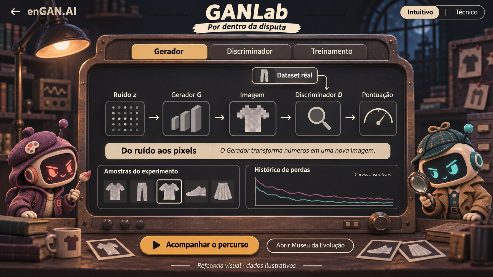
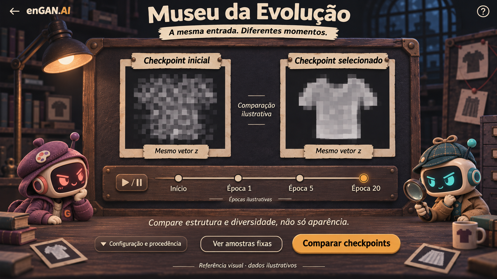
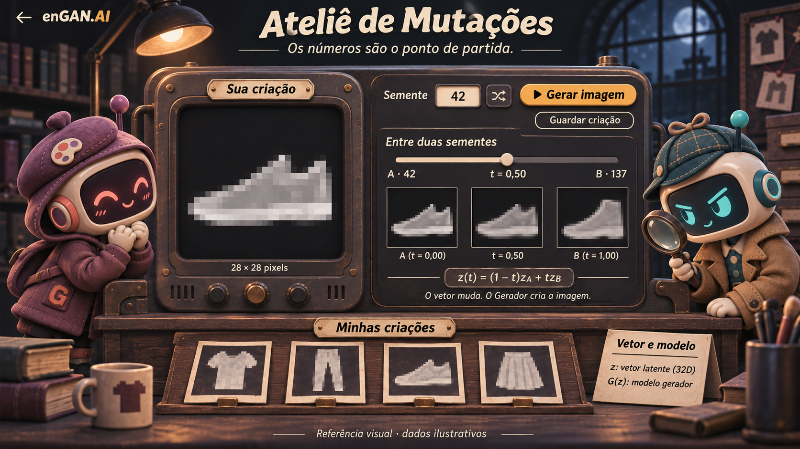

# enGAN.AI — Ateliê de Investigação dos Pixels

Proposta de evolução do módulo para uma aventura de investigação, com cenário persistente, personagens mais expressivos e cor concentrada nas decisões do jogador.

Direção aprovada. A consolidação e os contratos estão na [Etapa 01 concluída](../etapa-01/README.md). O ZIP abaixo preserva o pacote original de apresentação da proposta.

**Entrega desta rodada:** análise das sete inspirações, análise do projeto atual, plano de implementação lógica e visual, nove mockups de desktop e uma adaptação móvel. A aplicação não foi modificada nesta rodada.

- [Plano completo e critérios de conclusão](PLANO.md)
- [Prompts de geração](prompts.json)
- [Pacote para baixar](enganai-proposta-visual.zip)

Todas as telas foram geradas com a ferramenta integrada de imagens do ChatGPT (`image_gen`). A primeira estabelece a direção de arte; as outras usam essa tela como referência para manter figurinos, materiais, iluminação e linguagem de interface consistentes. Os dados e amostras nas imagens são ilustrativos. Não são saídas de uma GAN treinada nem evidência de recursos já implementados.

## Telas

| Tela | Referência | Decisão principal |
| --- | --- | --- |
| 01 · Entrada | [Abrir imagem](telas/01-inicio.png) | Cenário e rivais conduzem ao início da missão |
| 02 · Mural | [Abrir imagem](telas/02-missoes.png) | Casos, disponibilidade e progresso sem menu de painel |
| 03 · Investigação | [Abrir imagem](telas/03-arena.png) | Uma amostra central, duas escolhas e tempo para observar |
| 04 · Revelação | [Abrir imagem](telas/04-revelacao.png) | Origem registrada separada do palpite da Lupa |
| 05 · Relatório | [Abrir imagem](telas/05-relatorio.png) | Resultado da missão e caminho para revisitar as respostas |
| 06 · GANLab | [Abrir imagem](telas/06-ganlab.png) | Instrumento científico dentro do universo do jogo |
| 07 · Museu | [Abrir imagem](telas/07-museu.png) | Comparação com o mesmo vetor e linha do tempo |
| 08 · Mutações | [Abrir imagem](telas/08-mutacoes.png) | Geração por semente e interpolação no espaço latente |
| 09 · Caos | [Abrir imagem](telas/09-caos.png) | Comparação de execuções e análise de diversidade |
| 10 · Celular | [Abrir imagem](telas/10-arena-mobile.png) | Evidência e botões reorganizados para uma coluna |

## 01 · Entrada imersiva

## 02 · Mural de missões

## 03 · Investigação

## 04 · Revelação da origem

## 05 · Relatório da missão

## 06 · GANLab

## 07 · Museu da Evolução

## 08 · Ateliê de Mutações

## 09 · Câmara do Caos

## 10 · Arena no celular

## Como transformar a referência em aplicação

As imagens definem direção de arte e composição. Cenários e personagens serão assets separados; textos, botões, foco, gráficos e estados serão componentes acessíveis no React. A inferência e os dados serão implementados conforme os contratos descritos no plano. O menu não será uma imagem única com zonas clicáveis.

Diferenças de texto, escala e proporção do mockup podem ser corrigidas durante a implementação para preservar legibilidade. As curvas ilustrativas do GANLab não prescrevem um comportamento de convergência; os gráficos finais virão dos registros reais.
